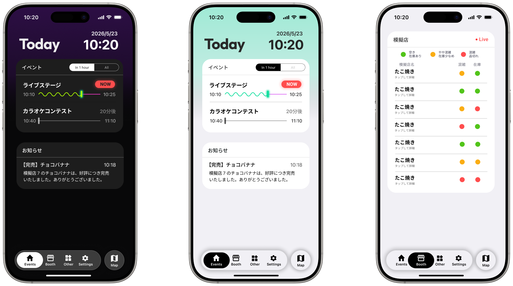

<p align="center">
  <a href="https://festime.suba.pro" target="_blank">
    <picture>
      <source media="(prefers-color-scheme: dark)" srcset="./assets/logo-dark.svg">
      <source media="(prefers-color-scheme: light)" srcset="./assets/logo-light.svg">
      
    </picture>
  </a>
</p>

  FesTime は、文化祭やイベントでのリアルタイムな情報共有を可能にするための汎用型オープンソース・フレームワークです。
模擬店の混雑状況、イベントの進行状況、交通機関の案内、投票、落とし物管理など、イベント運営に必要な機能が含まれています。

[公式ドキュメントページ](https://festime.suba.pro) |
[FesTime Studio (カスタマイズツール)](https://festime.suba.pro/studio) |
[最新版アプリZip](https://github.com/rsu-Suba/FesTime/releases)



## FesTime Studio
コードを編集せず、Webブラウザ上でイベント設定・データ入力・レイアウトを直感的にカスタマイズできる **FesTime Studio** を提供しています。
- ステップごとに対話的にアプリの設定が可能
- ブラウザ上でリアルタイムプレビュー確認
- CSV / JSONからのマスターデータインポート
- カスタム設定の自動適用パッチ生成

## Quick Start
### 1. プロジェクトファイル入手
- 最も手軽 (推奨) : [最新のReleases](https://github.com/rsu-Suba/FesTime/releases) から `festime-app.zip` をダウンロードして解凍
- または Git クローン : 
  ```bash
  git clone https://github.com/rsu-Suba/FesTime.git
  cd FesTime
  ```
### 2. 依存関係インストール & ローカル起動
  ```bash
  npm install
  npm run dev
  ```

## 主な機能

### 来場者向け
- #### 模擬店・展示
  - **模擬店リアルタイム状況**: 全模擬店の「混雑度」と「在庫状況」を信号機形式（緑・黄・赤）で一覧表示。Supabase Realtime により、現地に行かなくても最新の状況を即座に把握できます。
  - **現在地連動・周辺情報表示**: 校内に掲示された QR コードを読み取ることで、そのスポット周辺の模擬店や展示の情報を即座にピックアップして表示します。
  - **インタラクティブなキャンパスマップ**: Leaflet を活用し、模擬店、展示、イベントステージの場所を直感的に探すことができます。

- #### 時間関係
  - **タイムテーブル & 進行状況表示**: ステージ企画の進行状況をバー形式で可視化。直近の予定に絞るフィルタリング機能も搭載。
  - **バス時刻表**: 現在時刻から乗れるバスを優先表示します。

- #### 進行関係
  - **リアルタイム・ニュース配信**: 運営からの重要告知を即座に受信。最新の投稿には「New」バッジが付与されます。
  - **写真付き落とし物リスト**: 忘れ物の情報を写真付きで閲覧。画像表示のオン/オフでデータ通信量にも配慮。
  - **匿名 Q&A 掲示板**: 運営に匿名で質問が可能。回答済みと未回答を分けて分かりやすく表示。
  - **オンライン投票**: 模擬店・展示部門のリアルタイム投票。IP / LocalStorage による多重投票防止機能を備えています。

- アプリ設定
  - ライトテーマ / ダークテーマ
  - 日本語 / 英語に対応しています。
    - 対応言語は拡張可能です。

### 運営・出店団体向け
- **ブース管理マネージャー**: 出店担当者がスマホから数タップで「混雑度」と「在庫状況」を更新可能。
- **模擬店シフト引き継ぎ**: QRコードによるシフト交代機能。セキュアなトークンを用いてログイン状態を安全に引き継げます。
- **総合管理パネル (Admin)**: お知らせの配信、落とし物登録（画像自動圧縮アップロード）、Q&A への回答管理。
- **リアルタイム集計**: 投票状況をカテゴリごとにランキング形式で即時確認。
- **サーバーステータス監視**: Supabase との接続状況やテーブルの健全性をリアルタイムにモニタリング。


## 運用実績

### [第18回 北斗祭 (富山高専 射水), 2026](https://github.com/HokutoFes26/app)
FesTime は第18回 北斗祭のために開発されました。2日間の開催期間中、多くの来場者・学生に利用されました。
- **活用内容**: 模擬店のリアルタイム混雑管理、即時ニュース配信、ステージ企画の進行表示、公式投票システムとしての利用。
- **実績**: 1,400ユーザーを安定して処理し、イベント運営のデジタル化に大きく貢献しました。
- **詳細**: [北斗祭リファレンス実装リポジトリ](https://github.com/HokutoFes26/app)


## 技術スタック

[](https://skillicons.dev)

### フロントエンド
*   **Framework:** Next.js 15 (App Router / Static Export)
*   **Language:** TypeScript
*   **Library:** React 19, Ant Design, Material UI Icons, Framer Motion
*   **Map:** Leaflet, React Leaflet
*   **i18n:** i18next, react-i18next
*   **Deployment:** GitHub Pages

### バックエンド
*   **BaaS:** Supabase (Database, Auth, Realtime)

---

### ドキュメント
このプロジェクトを利用するには[詳細ドキュメントページ](https://festime.suba.pro/guide/getting-started/)を参照してください。

### 貢献・ライセンス

バグ報告や機能提案は Issue または Pull Request にてお待ちしております。
本プロジェクトは [Apache License 2.0](LICENSE) のもとで公開されています。
